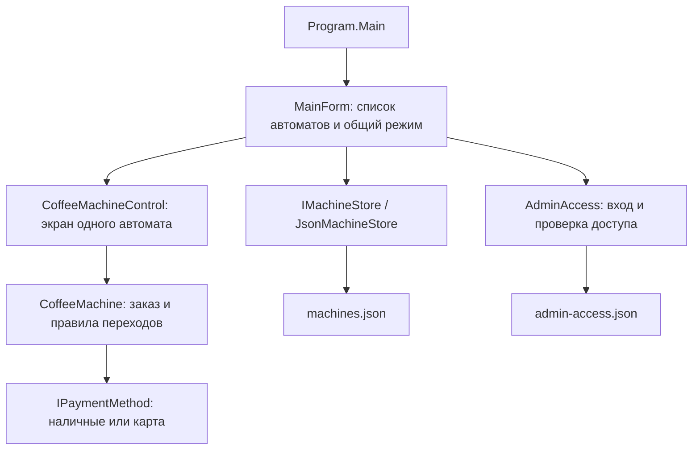

# CoffeeAutomat: объяснение проекта для защиты

Это руководство описывает текущую реализацию **BEAN & CUP на C# / .NET 8 / Windows Forms**: режим администратора с паролем, независимые автоматы, JSON, карту и сдачу, меню по шесть напитков на странице.

Цель — понимать, как устроен код, и уметь показать нужное место преподавателю. Формулировки для выступления ниже можно пересказать своими словами.

## Как пользоваться материалом

1. Сначала прочитайте [короткий план выступления](QUICK_DEFENSE.md).
2. В этом документе разберите архитектуру, ООП, причины решений и примеры работы.
3. Для вопроса «что делает этот метод?» откройте соответствующий справочник:

| Справочник | Что в нём |
|---|---|
| [Модель и оплата](MODELS.md) | `Beverage`, `CoffeeOrder`, `MachineConfiguration`, `CoffeeMachine`, `CashPayment`, `CardPayment`, `IPaymentMethod`, состояния и все явно объявленные методы модели |
| [Хранение и вход администратора](STORAGE.md) | `IMachineStore`, `JsonMachineStore`, `AdminAccess`, `AdminLoginForm`, JSON, пароль и все их явно объявленные методы |
| [Окна и графика](UI.md) | Главное окно, компонент автомата, редактор, карточки, анимации, изображения, стили и все их явно объявленные методы |

В справочниках описаны методы, написанные в проекте. Унаследованные сотни методов `Form`, `Button`, `Control` и автоматически создаваемые компилятором члены `record` не переписаны из документации .NET.

## 1. Что делает программа

Программа моделирует покупку кофе: выбор напитка и добавок, внесение наличных или вставление карты, оплату, приготовление, отдельное получение чашки и сдачи, возврат карты. Можно создать несколько независимых автоматов в одном окне.

В режиме администратора меняются меню, цены и параметры напитков; можно добавлять, копировать и удалять автоматы. Настройки записываются в JSON и восстанавливаются после перезапуска. Вход администратора защищён локальным паролем.

Это **учебный симулятор**. Он не управляет нагревателем, не подключён к банку, не ведёт склад ингредиентов и не сохраняет историю продаж. Карта специально имеет неограниченные демонстрационные средства.

## 2. Структура решения

```text
CoffeeAutomat.sln                  Решение Visual Studio: объединяет два проекта
global.json                       Выбор SDK для сборки
CoffeeMachineApp2/
  CoffeeMachineApp.csproj          Приложение net8.0-windows, WinForms
  Program.cs                      Точка входа, блокировка повторного запуска
  Models/                         Данные и правила покупки
    Beverage.cs                   Описание вида напитка
    CoffeeOrder.cs                Конкретный заказ и его стоимость
    MachineConfiguration.cs       Сохранённые настройки одного автомата
    CoffeeMachine.cs              Текущее состояние работающего автомата
    Payment.cs                    Интерфейс оплаты, наличные и карта
  Storage/                        Файлы и локальный доступ администратора
    JsonMachineStore.cs           Контракт хранилища и реализация для JSON
    AdminAccess.cs                Пароль и состояние админского сеанса
  Forms/                          Окна, элементы управления, отрисовка
  Assets/                         Встроенные изображения напитков
CoffeeMachineApp.Tests/
  CoffeeMachineApp.Tests.csproj    Консольные проверки без Windows Forms
  Program.cs                      Проверки модели, оплаты и JSON
  AdminAccessChecks.cs             Проверки пароля и доступа
docs/                             Материалы для защиты
```

Папка приложения исторически называется `CoffeeMachineApp2`, но имя проекта и сборки — `CoffeeMachineApp`. Цифра в имени папки не означает второй запускаемый автомат: автоматы создаются как объекты во время работы.

`.sln` объединяет проекты, а `.csproj` описывает сборку одного проекта. `bin` содержит результаты сборки, `obj` — промежуточные файлы. Их не нужно хранить в Git.

## 3. Как разделены обязанности

| Часть | Её задача | Пример |
|---|---|---|
| `Models` | Правила, которые должны выполняться независимо от экрана | Нельзя оплатить заказ дважды или получить кофе до готовности |
| `Forms` | Принимать нажатия, вызывать действия модели и показывать результат | Кнопка оплаты вызывает `Machine.Pay()`, затем обновляет экран |
| `Storage` | Читать и записывать настройки, проверять локальный доступ | `JsonMachineStore.Save()` сохраняет список конфигураций |

`Models` не использует Windows Forms и не читает файлы. `Storage` знает типы модели, потому что сохраняет их. Формы связывают модель, хранилище и ввод пользователя.

Это разделение обязанностей внутри небольшого приложения. Называть его полноценным MVC, MVVM или «чистой архитектурой» было бы неточно: отдельного контроллера или слоя сценариев приложения здесь нет, часть координации находится в обработчиках форм.



### Три класса, которые особенно важно не путать

- `MachineConfiguration` — **настройки**: ID, название и меню. Их нужно сохранять.
- `CoffeeMachine` — **работающий автомат**: настройки плюс текущий заказ, состояние оплаты, карта и сдача. Его временное состояние не сохраняется.
- `CoffeeMachineControl` — **изображение и управление автоматом**: кнопки, карточки, терминал, таймер и подсказки.

Так модель можно проверять без окна, а внешний вид — изменять без переписывания расчёта денег.

## 4. Где именно здесь ООП

| Понятие | Пример из проекта | Как объяснить |
|---|---|---|
| Класс и объект | Класс `CoffeeMachine`, несколько `new CoffeeMachine(config)` | Класс описывает устройство; каждый объект имеет своё состояние |
| Инкапсуляция | `State`, `Order`, `Change` имеют `private set`; переходы выполняются методами | Внешний код читает состояние, но не должен произвольно присваивать ему новое значение |
| Абстракция | `IPaymentMethod.Pay(decimal total)` | Автомату важен общий контракт оплаты, а внутренние правила наличных и карты различаются |
| Полиморфизм | Через `IPaymentMethod` вызывается `CashPayment.Pay` или `CardPayment.Pay` | Один вызов выбирает конкретное поведение объекта во время выполнения |
| Наследование | `MainForm : Form`, `CoffeeMachineControl : UserControl`, `RoundedButton : Button` | Собственные элементы расширяют готовые классы WinForms и переопределяют отрисовку |
| Композиция | У `CoffeeMachine` есть заказ, наличные и карта; у главного окна — несколько компонентов | Большой объект собирается из объектов с отдельными обязанностями |

**Почему нет отдельного класса `Latte` или `Cappuccino`?** Их поведение в этой модели одинаково: отличаются цена, рецепт, изображение, время и флаги. Это данные `Beverage`. Новый рецепт можно добавить в админке, не создавая новый C#-класс и не пересобирая приложение. Если в будущем появится принципиально иной алгоритм приготовления, тогда можно выделить отдельную стратегию приготовления.

**Почему в README говорится о шести классах, хотя файлов больше?** Речь только о предметной модели: три `record` (`Beverage`, `CoffeeOrder`, `MachineConfiguration`) и три обычных класса (`CoffeeMachine`, `CashPayment`, `CardPayment`). Интерфейс, перечисление, формы и вспомогательные классы считаются отдельно. ООП не требует минимального числа файлов любой ценой; важно, чтобы каждый тип имел понятную обязанность.

Инкапсуляция не абсолютна: `Cash` и `Card` открыты как объекты со своими публичными методами. Обычный UI использует методы `CoffeeMachine`, но другой код теоретически может вызвать платёжный объект напрямую. Усиление границы — возможное развитие проекта, а не уже реализованное свойство.

### Пример полиморфизма

В `CoffeeMachine.Pay()` используется такой код:

```csharp
IPaymentMethod payment = UseCard ? (IPaymentMethod)Card : Cash;
Change = payment.Pay(Order.Total);
State = MachineState.Brewing;
```

У наличных `Pay()` проверяет внесённую сумму, обнуляет её и возвращает сдачу. У карты `Pay()` требует вставленную карту и возвращает ноль. Приведение к `IPaymentMethod` не создаёт новую карту и не копирует её: меняется тип ссылки, через которую вызывается метод.

Интерфейс здесь позволяет отделить вызов от реализации. При добавлении третьего способа оплаты понадобится не только реализация интерфейса, но и изменение выбора способа и UI: текущий `bool UseCard` рассчитан на два варианта.

## 5. Почему приняты эти технические решения

| Решение | Почему оно подходит | Цена решения или ограничение |
|---|---|---|
| C# и Windows Forms | Готовые окна, события, кнопки и отрисовка; приложение для Windows без сервера | Сам интерфейс требует Windows |
| .NET 8 | Современный C#, встроенные JSON и криптография, один SDK для приложения и проверок | На целевом компьютере нужен Desktop Runtime 8 либо self-contained сборка |
| `decimal` для денег | Точно представляет используемые десятичные рубли и копейки; нет типичной двоичной погрешности `double` | Допустимые суммы всё равно проверяются: до двух десятичных знаков |
| `record` и `with` для данных | Удобно создать изменённый вариант, не менять объект текущего заказа; сравнение записей по значениям их членов | `with` копирует поверхностно; вложенную коллекцию нужно защищать отдельно |
| `Snapshot()` | Новый контейнер меню защищает модель от последующего изменения исходного списка вызывающим кодом | Это не универсальный глубокий клон любого графа объектов |
| GUID для ID | Название можно менять; идентичность объекта остаётся той же | ID не предназначен для удобного чтения человеком и сам по себе не является правом доступа |
| `enum MachineState` и проверки | Четыре этапа легко прочитать и проверить; не требуется отдельный класс для каждого состояния | Большое число новых этапов потребует пересмотра переходов |
| `IPaymentMethod` | Два варианта оплаты имеют общий контракт | Выбор варианта пока явно написан в модели |
| `IMachineStore` | Главное окно получает зависимость через конструктор; хранение можно заменить | Сейчас реализация только одна — JSON; DI-контейнер для такого размера не нужен |
| JSON вместо базы данных | До 12 автоматов по 100 напитков, один локальный пользователь; файл легко переносить и читать | Нет запросов к истории продаж, сервера и поддержки совместной записи |
| Временный файл перед заменой JSON | При ошибке сериализации рабочий файл не остаётся наполовину записанным | Это не резервное копирование и не транзакция нескольких файлов |
| Настройки в `LocalApplicationData` | Папка предназначена для данных текущего пользователя; обновление `.exe` не стирает меню | Данные принадлежат профилю Windows, а не доступны всем пользователям автоматически |
| Один компонент `CoffeeMachineControl` на экземпляр | Второй автомат создаётся без второй копии кода окна | Каждый экземпляр всё равно потребляет память и имеет собственный таймер |
| События для копирования и удаления | Компонент сообщает о намерении; главное окно управляет общим списком | Сохранение списка координируется главным окном |
| `Timer` и `Stopwatch` | Таймер обновляет кадры, секундомер считает прошедшее время | UI-таймер не даёт точного реального времени и не создаёт отдельный поток |
| Собственная отрисовка | Единый вид карточек, корпуса, карты, стакана и сдачи | Больше графического кода и необходимость визуальной проверки на Windows |
| Страницы 3 × 2 | Карточки помещаются в экран; добавленные напитки не вызывают полос прокрутки | Для большого меню нужно перелистывать страницы |
| Общий админский режим | Все изменения доступны после одного входа; при обслуживании покупка приостановлена | Нет отдельных ролей, пользователей и прав на разные автоматы |
| PBKDF2 с солью для пароля | На диск не попадает исходный пароль; одинаковые пароли имеют разные хеши | Локальный файл не защищён от владельца файловой системы; нет ограничения числа попыток |

## 6. Один заказ: от нажатия до выдачи

Рассмотрим стандартный эспрессо за 120 ₽, три ложки сахара, дополнительное молоко и ваниль. Итог: **120 + 10 + 30 + 30 = 190 ₽**. Надбавка за 3–4 ложки сахара фиксированная, а не за каждую ложку.

1. Нажатие карточки вызывает `Machine.Select(id)`. Автомат проверяет этап и доступность напитка, создаёт `CoffeeOrder`.
2. Кнопки добавок вызывают `Configure(...)`. Модель создаёт новый вариант заказа через `with`, проверяет его и только после этого заменяет `Order`.
3. `RefreshView()` читает `Order.Total` и показывает 190 ₽. Формула цены находится в заказе, а не в кнопке.
4. `BeginPayment()` переводит модель из `Choosing` в `Paying`.
5. Внесение 500 ₽ вызывает `InsertMoney(500)`, затем `Cash.Insert(500)`.
6. `Pay()` вызывает конкретный платёжный объект. `CashPayment.Pay(190)` возвращает 310 ₽ сдачи, а `CoffeeMachine` переходит в `Brewing`.
7. UI запускает `Stopwatch` и таймер. В `Tick()` прогресс вычисляется по реально прошедшему времени; по завершении вызывается `FinishPreparing()`.
8. `CollectDrink()` отмечает получение чашки. Если сдача ещё лежит в лотке, заказ остаётся `Ready`.
9. `CollectChange()` возвращает 310 ₽ и обнуляет сдачу. Когда получены все необходимые предметы, `TryCompleteOrder()` вызывает `Reset()`.

Та же последовательность без интерфейса выглядит так:

```csharp
var config = MachineConfiguration.CreateDefault();
var machine = new CoffeeMachine(config);
machine.Select(config.Menu[0].Id);
machine.Configure(3, true, "Ваниль");
machine.BeginPayment();
machine.InsertMoney(500);
machine.Pay();                         // Brewing; сдача = 310
machine.FinishPreparing();             // В приложении вызывается по таймеру
machine.CollectDrink();                // Ready: сдача ещё не получена
decimal change = machine.CollectChange(); // 310; возврат в Choosing
```

Это пример использования модели, а не отдельная реализованная функция. В тестах применяются те же операции.

При карте сначала вызываются `SelectPayment(true)` и `InsertCard()`. Оплата без вставленной карты отклоняется. После оплаты карту можно забрать ещё во время приготовления. Если чашка уже получена, а карта осталась, новый заказ не начинается до `EjectCard()`.

Отключённая кнопка помогает пользователю, но сама по себе не гарантирует правильность. Поэтому модель тоже проверяет этап: повторный вызов `Pay()` после оплаты выбросит `InvalidOperationException`.

## 7. Админское изменение: от поля цены до JSON

Цепочка сохранения:

```text
MainForm.SwitchMode()
  → AdminLoginForm → AdminAccess.CreatePassword() / Login()
  → CoffeeMachineControl.OpenAdmin()
  → AdminForm: редактирование собственного списка _draft
  → AdminForm.Save(): ApplyEditor(), config.Validate(), _save(config)
  → MainForm.SaveConfiguration(): RequireAdministrator(), _store.Save(...)
  → CoffeeMachine.UpdateConfiguration(config)
  → обновление карточек на экране
```

`_save` — переданный обработчик (`Action<MachineConfiguration>`). Окно редактора не обязано знать, как и куда главное окно сохраняет все автоматы.

Ключевой порядок: **сначала проверить и записать файл, затем применить конфигурацию к работающей модели**. Если запись завершается ошибкой, текущая модель не получает новые цены. После успешной записи модель повторно проверяет настройки и снимает собственный снимок меню. Это последовательность локальных операций, а не транзакция между произвольными сервисами.

«Отмена» не вызывает сохранение и оставляет действующее меню прежним. Исключение касается импортированной картинки: она записывается на диск при импорте и может остаться неиспользованной после отмены редактора.

## 8. Как создаётся второй автомат

1. Компонент вызывает событие `DuplicateRequested`.
2. Подписанный обработчик в `MainForm` вызывает `AddMachine(machine.Configuration)`.
3. Проверяются права администратора и ограничение до 12 автоматов.
4. `Duplicate(name)` создаёт конфигурацию с новым ID автомата и новыми ID напитков.
5. Новый список сохраняется в JSON.
6. `Attach(next)` создаёт **новые** `CoffeeMachine` и `CoffeeMachineControl`, подключает события и добавляет компонент в окно.

Поэтому цена в копии, наличные, карта, заказ, страница меню и таймер не меняют состояние соседа. Общие объекты — хранилище, админский сеанс, стили и кеш изображений. Не всё в приложении изолировано, изолировано именно рабочее состояние автоматов.

## 9. Точка входа и настройки сборки

Исходник: [Program.cs](../CoffeeMachineApp2/Program.cs).

| Элемент | Назначение |
|---|---|
| `Program` | Статический служебный класс с точкой входа приложения |
| `[STAThread]` | Задаёт STA-модель главного потока для Windows-компонентов, например системных диалогов; это не запуск дополнительного потока |
| `Main()` | Настраивает DPI и визуальные стили, создаёт папку данных и эксклюзивную файловую блокировку, запускает главное окно, показывает ожидаемые ошибки запуска |
| `Application.Run(...)` | Запускает цикл обработки сообщений окна: нажатий, перерисовок, таймеров; возвращается после закрытия главного окна |
| `using var appLock` | Держит файл `machines.json.lock` открытым с `FileShare.None` до конца работы; освобождает файловый дескриптор при выходе |
| `catch (...) when (...)` | Обрабатывает перечисленные ожидаемые ошибки файлов/JSON/аргументов; не означает перехват всех возможных исключений |

Блокировка нужна против двух **процессов программы**, записывающих один файл. Несколько объектов автоматов **в одном окне** разрешены. Файл `.lock` может оставаться после закрытия: важен открытый дескриптор, а не само наличие файла.

В `.csproj`: `WinExe` создаёт оконное приложение; `UseWindowsForms` подключает WinForms; `net8.0-windows` задаёт платформу; `EnableWindowsTargeting` разрешает собирать Windows-проект на другой ОС. Последнее не позволяет запускать WinForms на Linux. `Assets` копируется к сборке через `CopyToOutputDirectory`.

`global.json` выбирает SDK, а `TargetFramework` — платформу, для которой собирается приложение. Разрешение более нового SDK через `rollForward: major` не меняет автоматически целевую .NET 8. SDK нужен для разработки; Desktop Runtime — для обычного запуска; self-contained сборка включает runtime.

## 10. Как устроены проверки

В [CoffeeMachineApp.Tests](../CoffeeMachineApp.Tests/Program.cs) находится **31 исполняемая проверка**: 27 сценариев модели/файлов и 4 группы проверок доступа. Это собственный консольный запускатель, а не xUnit или NUnit.

```sh
dotnet build CoffeeAutomat.sln
dotnet run --project CoffeeMachineApp.Tests/CoffeeMachineApp.Tests.csproj
```

Проверяются недоплата и повторная оплата, переходы состояний, возврат денег, карта без лимита, отдельная выдача, точность копеек, независимость автоматов, копирование коллекций, сохранение/чтение JSON, повреждённые данные, ошибки записи и пароль.

| Класс и метод | Что делает |
|---|---|
| Тестовый `Program.Main()` | Создаёт уникальную временную папку, запускает сценарии, удаляет папку в `finally`, печатает итоги и устанавливает код возврата 0/1 |
| `NewMachine()` | Создаёт автомат со стандартной конфигурацией для очередной проверки |
| `Paying()` | Создаёт автомат, выбирает первый напиток и переводит его на оплату |
| `Check(condition, message)` | Если условие ложно, выбрасывает исключение с объяснением ошибки теста |
| `Equal<T>(expected, actual)` | Сравнивает значения через `EqualityComparer<T>.Default`; при расхождении проваливает проверку |
| `Throws<T>(Action action)` | Выполняет действие и требует исключение указанного типа; отсутствие такого исключения считается ошибкой |
| `Run(name, Action test)` | Перехватывает ошибку отдельного сценария, считает PASS/FAIL и позволяет продолжить остальные сценарии |
| `AdminAccessChecks.Run(run, temp)` | Регистрирует четыре группы сценариев пароля через переданный обработчик запуска и временную папку |
| `AdminAccessChecks.Check(...)`, `Throws<T>(...)` | Локальные вспомогательные проверки утверждений и исключений для этого файла |

Два класса `Program` находятся в разных проектах/сборках и имеют разные точки входа. Приложение запускает окно, тестовый проект — проверки.

Тестовый `.csproj` включает **те же исходные файлы** `Models/*.cs` и `Storage/*.cs` через `Compile Include`. Поэтому в тестах нет зависимости от WinForms, и их можно выполнять на Linux. Для более крупного проекта эти типы логично вынести в отдельную библиотеку и подключать через `ProjectReference`; здесь это ещё не сделано.

Прохождение 31 проверки не доказывает отсутствие всех ошибок. Эти проверки не запускают окна, не нажимают реальные кнопки, не проверяют раскладку/DPI и не измеряют защиту от атак. Для интерфейса нужна отдельная проверка на Windows.

## 11. Синтаксис C#, о котором могут спросить

| Конструкция | Объяснение на примере проекта |
|---|---|
| `public` / `private` / `protected` / `internal` | Доступ отовсюду / внутри типа / внутри типа и наследников / внутри сборки |
| Конструктор | Метод с именем класса без возвращаемого типа; вызывается при `new` и подготавливает объект |
| Свойство и поле | `_path` — поле хранения; `DefaultPath` — свойство, вычисляющее путь; `Total` — вычисляемое свойство цены, не отдельный метод оплаты |
| `private set` | Читать свойство можно снаружи, присваивать — только внутри типа |
| `init` | Значение задаётся при инициализации записи, в том числе в выражении `with`; обычное последующее присваивание запрещено |
| `readonly` | Ссылку поля нельзя переприсвоить после инициализации/конструктора; объект по ссылке не становится автоматически неизменяемым |
| `const` | Константа времени компиляции, например размер страницы меню |
| `static` | Член относится к типу, а не к одному экземпляру; так реализованы стили и создание стандартной конфигурации |
| `sealed` | Запрещает наследование от типа; это не запрет менять состояние объекта |
| `record` | В этом проекте ссылочный тип с генерируемыми сравнением по значениям членов, копированием для `with` и другими служебными членами |
| `with` | Создаёт новый вариант записи; изменённая цена не присваивается прежнему объекту `Beverage` |
| `override` | Замена виртуального поведения базового класса, например `OnPaint`; не то же самое, что перегрузка метода |
| `interface` | Контракт программного взаимодействия; это другой смысл слова «интерфейс», чем окно с кнопками |
| `var` | Компилятор выводит статический тип; переменная не становится `dynamic` |
| `List<T>` / `IReadOnlyList<T>` | Изменяемый список / контракт чтения списка; второй сам по себе не гарантирует неизменность исходного объекта |
| `Dictionary<RoundedButton, Beverage>` | Связывает отображаемую кнопку с данными напитка |
| `decimal`, суффикс `m` | Денежный десятичный тип; `245.50m` — литерал именно этого типа |
| `Action`, `Action<T>` | Делегаты действий без возвращаемого результата; позволяют передать обработчик сохранения или теста |
| `event EventHandler` | Подписчики получают уведомление о событии; `DuplicateRequested` отделяет кнопку от управления списком автоматов |
| `(s, e) => ...` | Лямбда — короткий обработчик события; `s` — источник, `e` — аргументы события |
| `?.`, `??` | Безопасный доступ при возможном `null` и значение по умолчанию; например `order?.Sugar ?? 0` |
| `Where`, `Select`, `Skip`, `Take`, `ToArray` | LINQ: отбор, преобразование, пропуск, ограничение количества и материализация результата; так строятся меню и страницы |
| `using` в начале файла | Подключает пространство имён для коротких имён типов |
| `using var` около объекта | Гарантирует вызов `Dispose()` при выходе из области, в том числе при исключении |
| `try/catch/finally` | Выполнить действие, обработать ошибку, обязательно выполнить очистку |
| `Invalidate()` | Запрашивает перерисовку; сам непосредственно не выполняет покупку и не вызывает модель |

## 12. Вопросы преподавателя и ответы

### Почему цена считается не в форме?

Цена — правило заказа. В `CoffeeOrder.Total` одна формула для UI, оплаты и тестов. Иначе экран мог бы показывать одну сумму, а платёж списывать другую.

### Почему нельзя просто сделать все методы и поля публичными?

Тогда внешний код мог бы поставить `State = Ready` без оплаты. Закрытые сеттеры и методы переходов удерживают допустимый порядок. При этом у платёжных объектов остаются открытые операции — граница инкапсуляции может быть усилена.

### Зачем хранить и настройки, и заказ?

Меню описывает то, что автомат продаёт; заказ — конкретный выбранный напиток с сахаром и добавками. Один и тот же `Beverage` может участвовать в разных заказах. Изменение заказа не должно менять рецепт в меню.

### Почему интерфейс хранилища нужен, если JSON-реализация одна?

У главного окна узкий контракт: загрузить и сохранить конфигурации. Конструктор получает этот контракт, поэтому способ хранения можно заменить. Это небольшая граница из двух методов; дополнительные репозитории, фабрики и DI-контейнер сейчас не потребовались.

### Какие паттерны здесь есть?

Можно показать оплату как простой вариант выбора стратегии, передачу зависимостей через конструктор и подписку на события. Состояния реализованы перечислением и проверками; классов паттерна State нет. Применение LINQ или JSON само по себе не является отдельным архитектурным паттерном.

### Насколько соблюдается SOLID?

Есть разделение основных обязанностей, небольшие интерфейсы и зависимость главного окна от контракта хранилища. Не стоит утверждать идеальное соблюдение всех принципов: формы содержат и раскладку, и обработчики сценариев; третий способ оплаты потребует изменения кода выбора. Для учебного проекта выбран понятный объём абстракций.

### Почему два автомата работают одновременно без отдельных потоков?

Объекты и таймеры разные, но события WinForms обрабатываются одним UI-потоком. Каждое событие быстро обновляет свой автомат. Это визуально одновременная симуляция, а не параллельное управление физическим оборудованием.

### Почему нельзя использовать `Thread.Sleep()` для приготовления?

Если вызвать его в UI-потоке, окно перестанет отвечать на нажатия и перерисовываться. Таймер позволяет возвращать управление циклу сообщений между кадрами. Точный прогресс берётся из `Stopwatch`, потому что задержки `Tick` могут различаться.

### Почему пользователь не может менять цену?

В режиме покупателя кнопки обслуживания скрыты; при сохранении, добавлении и удалении в `MainForm` вызывается `RequireAdministrator()`. Модель сама не проверяет пароль: её задача — правила покупки. Эти две проверки не надо путать.

### Зачем запрещать вход администратора при активном заказе?

Чтобы обслуживание не прервало расчёт и не оставило деньги или карту в промежуточном состоянии. Проверяется отсутствие заказов во всех автоматах. В оплаченной покупке заказ исчезает только после необходимой выдачи.

### Что произойдёт, если закрыть программу во время покупки?

Главное окно предупредит о незавершённых заказах. Если подтвердить выход, временное состояние покупки сбросится. История, незабранная сдача и заказ не записываются в JSON. Для реальных денег это потребовало бы журнала операций и восстановления после сбоев.

### Что произойдёт при неправильном или повреждённом JSON?

Ошибка будет показана, стандартное меню не запишется поверх существующего файла. Стандартная конфигурация создаётся только при отсутствии файла. Есть проверки и формата JSON, и допустимости считанных данных.

### Можно ли открыть два экземпляра программы?

С одним каталогом настроек — нет: точка входа удерживает эксклюзивную блокировку. Это предотвращает потерю обновлений из-за двух записывающих процессов. Второй автомат внутри одного окна этому не мешает.

### Данные полностью неизменяемые?

Нет. `record` и `init` ограничивают обычное изменение свойств, но `with` делает поверхностную копию, а `IReadOnlyList` — только контракт. `Snapshot()` дополнительно копирует список и закрывает его обёрткой для чтения. Сама работающая модель должна быть изменяемой: состояние заказа меняется.

### Почему JSON сохраняется целиком, а не один изменённый напиток?

Объём ограничен: максимум 12 × 100 рецептов. Записать согласованный список проще, чем частично редактировать текст JSON. При больших объёмах или совместной работе более подходящим решением была бы база данных.

### Как добавить новый вид кофе? А новый способ оплаты?

Новый рецепт создаётся в админке как `Beverage` и сохраняется без изменения программы. Новый способ оплаты требует C#-реализации `IPaymentMethod` и доработки выбора способа/терминала. Это изменения разного уровня: данные и поведение.

### Что можно улучшить дальше?

По требованиям задачи: историю продаж и восстановление заказов, учёт ингредиентов, ограничение попыток входа, разделение ролей, отдельную библиотеку модели, автоматизацию UI-проверок. Это планы развития, а не уже существующие функции.

Вопросы о соли, хешировании, повреждении файла доступа и защите локальных данных отдельно разобраны в [справочнике хранения](STORAGE.md).

## 13. Как показать проект на защите

1. Запустите пользовательский режим. Покажите, что цены менять нельзя, а меню листается без полос прокрутки.
2. Выберите эспрессо с добавками. Объясните вычисляемое свойство `Total` и покажите его код.
3. Внесите 500 ₽. Покажите отдельную выдачу чашки и сдачи; назовите состояния модели.
4. В новом заказе вставьте карту, оплатите и заберите её. Объясните общий `IPaymentMethod`.
5. Войдите администратором, измените цену и добавьте напиток. Покажите, что седьмой напиток категории попадает на следующую страницу.
6. Скопируйте автомат и измените цену только в копии. Объясните `Duplicate()` и новые ID.
7. Перезапустите приложение и покажите сохранённые меню. Откройте `machines.json`, объясните его расположение и структуру.
8. Запустите консольные проверки и разберите один сценарий недоплаты или повторного получения сдачи.

Для любого незнакомого метода удобно отвечать по пяти пунктам: **кто вызывает → какие данные получает → что проверяет → что меняет/возвращает → что происходит при ошибке**. Это полезнее, чем запоминать текст функции наизусть.
